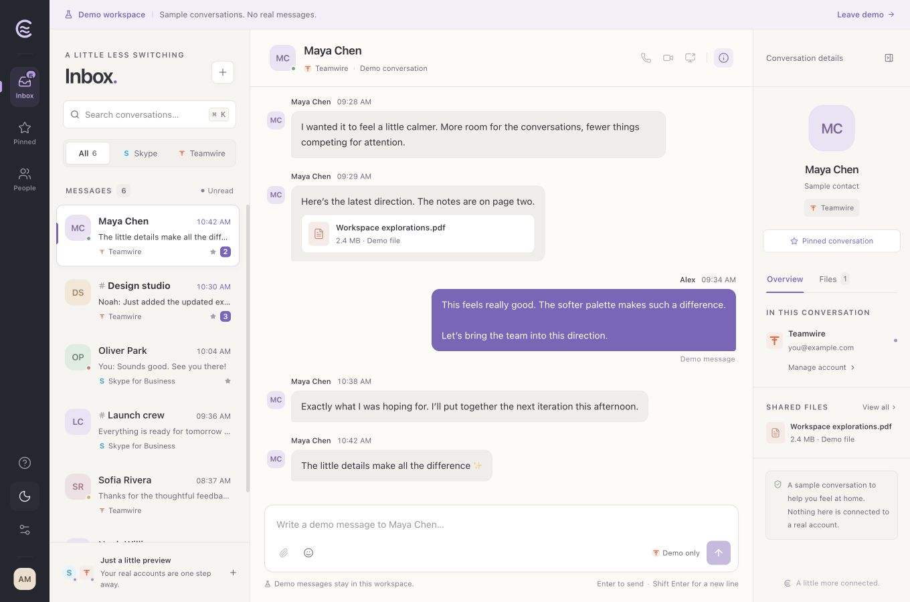
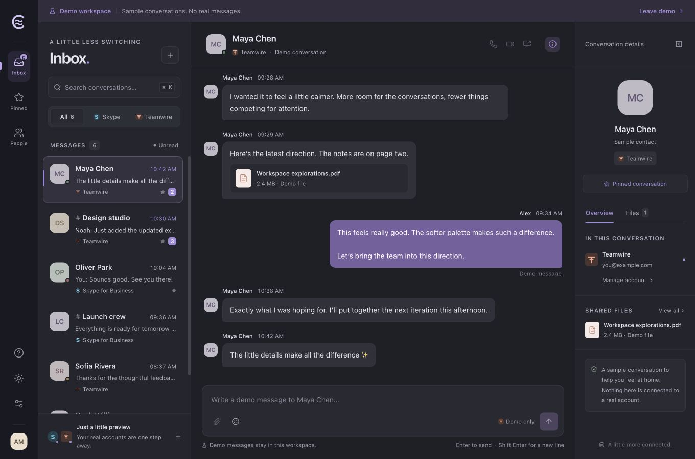
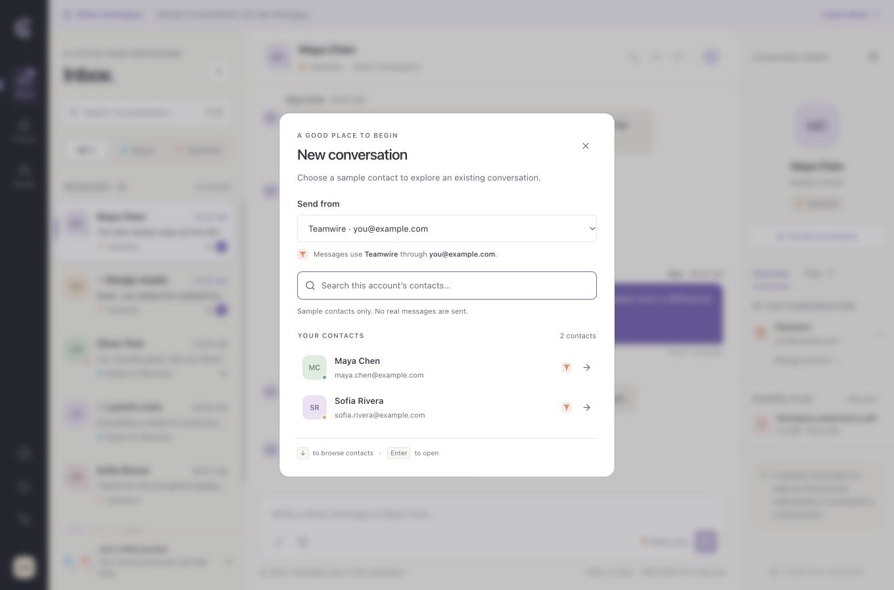

# Chattahoochee

A desktop messenger that brings **Skype for Business** and **Teamwire** into one workspace.

Built with **Tauri 2, React, TypeScript and shadcn/ui**, including the official Message, Bubble, Marker and MessageScroller chat components. Each conversation belongs to one account and one provider. Messages are sent through that provider; Chattahoochee does not bridge messages between services.

## Screenshots

The screenshots show the built app's explicit demo workspace with synthetic contacts and messages, after the November 4 UI review.

### Light



### Dark



### New conversation



## Current preview

- Unified inbox, provider filters, unread filter, search, contacts and pinned conversations.
- Message timeline, per-conversation drafts, emoji insertion, keyboard shortcuts and light/dark/system appearance.
- Separate live and synthetic demo workspaces. The demo never calls either service.
- Skype for Business: discovery, separate SIP and advanced login username, UCWA contacts, messaging sessions, incoming messages, text sending, typing and protocol delivery events through `skypeforhoo` 0.2.0.
- Teamwire: human email/password sessions, encrypted contacts/subscriptions/history, encrypted text sending, HTTP feed polling and read markers through the local `@openhoo/teamwire-sdk` workspace.
- Native HTTP transport with per-account HTTPS origins, system TLS trust, cancellation, duplicate authentication headers and bounded response sizes.

**Qualification:** automated protocol tests use synthetic servers. Real enterprise authentication and interoperability need a live account test. No live credentials or real messages were used to develop or verify this preview. macOS and Windows CI builds have succeeded; Windows interactive runtime behavior remains unverified.

### Features still being implemented

Audio, video, screen sharing and attachment transfers require additional native/protocol backends. Their controls are disabled in this preview. The SDK's media signaling types do not constitute a compatible media engine.

The Teamwire connector opens existing conversations. New conversation creation, interactive SSO/MFA, account enrollment and newer unsupported conversation encryption versions are not implemented. Unavailable encrypted text appears as an explicit placeholder.

Skype history covers the active UCWA session. Exchange conversation archives are not loaded. Read status and typing are exposed only when supported by the connector. HTTP acceptance is displayed separately from recipient delivery.

## Run

Requirements:

- Node.js 22.12 or newer and npm.
- Rust stable, at least 1.88, and the native Tauri prerequisites for your OS.
- macOS: Xcode Command Line Tools.
- Windows: Microsoft C++ Build Tools and WebView2.

```sh
npm ci
npm run desktop
```

For the browser UI preview:

```sh
npm run dev
```

Open `http://127.0.0.1:1420`. Choose **Explore demo**, or use `http://127.0.0.1:1420/?demo=1`. Browser previews support synthetic data only; live networking uses the native desktop broker.

### Account setup

1. Open **Workspace settings → Add account**.
2. Choose Skype for Business or Teamwire.
3. For Skype, enter your SIP/sign-in address and use **Advanced login username** for a different login username. Expand **Server settings** for an explicit discovery URL, or keep it empty for automatic discovery.
4. For Teamwire, supply an explicit HTTPS service origin and your account credentials.
5. Approve newly discovered Skype authentication/service origins only when you recognize them.

Passwords, tokens, account state, drafts and messages remain in memory. Only the appearance preference is written to local storage. Closing the app removes this session's local state; reconnect on the next launch. Logout failures are reported without claiming that server logout succeeded.

The app does not log request bodies or credentials. It does not retry message writes automatically. A failed or uncertain send stays visible, and a later authenticated provider echo can reconcile its status.

## Build and verify

```sh
npm run check
npm run test:coverage
npm exec playwright install -- --with-deps chromium firefox webkit
npm run test:e2e
cd src-tauri
cargo fmt --all -- --check
cargo test --locked
cd ..
```

The permanent suite contains **188 TypeScript tests**, **21 Rust tests**, and **77 UI scenarios across five browser/layout configurations (385 E2E checks)**. The browser matrix covers Chromium, Firefox, WebKit, and the 980×640 minimum window in Chromium and WebKit. Focus and navigation regressions also exercise the 700px layout. Each test starts in a fresh browser context. The shared E2E fixture rejects external HTTP requests and checks for browser errors. No retries mask failures.

Coverage is measured for the store/model, connectors, TypeScript native bridge and Teamwire SDK. `test:coverage` enforces at least **95% lines, 85% branches and 90% functions** for that combined scope; React views and Rust are tested separately. LCOV and a machine-readable summary are saved under `artifacts/coverage/`. CI uploads browser reports, JUnit results, and failure screenshots, traces and videos.

Create a macOS app bundle for local review:

```sh
npm run desktop:build -- --bundles app --no-sign --ci
```

Create a Windows NSIS installer on Windows:

```powershell
npm run desktop:build -- --bundles nsis --no-sign --ci
```

Builds without signing are local previews. Public distribution needs the platform's signing and release process. The GitHub Actions desktop workflow tests and builds macOS app archives and Windows NSIS installer artifacts.

## Project structure

| Path | Responsibility |
| --- | --- |
| `src/components` | React workspace and vendored shadcn chat primitives |
| `src/model` | Immutable app state, account ownership, delivery reconciliation, demo |
| `src/connectors` | Provider adapters using the two SDKs |
| `src/lib/native-transport.ts` | Fetch-compatible account HTTP bridge |
| `packages/teamwire-sdk` | Independently authored human-account Teamwire SDK |
| `src-tauri` | Native HTTP broker, cancellation, window/CSP/command scopes |
| `tests` | Store, native bridge and connector protocol tests |

See [architecture](docs/architecture.md), [verification](docs/verification.md), [UI review](docs/ui-ux-review.md), [dependency audit](docs/dependency-audit.md), [native transport](src-tauri/README.md), [Teamwire SDK](packages/teamwire-sdk/README.md) and [third-party notices](THIRD_PARTY_NOTICES.md).

## License

Original project code is MIT licensed. Provider names are used to describe compatibility; this is an independent project. Vendored shadcn components retain their MIT attribution.
