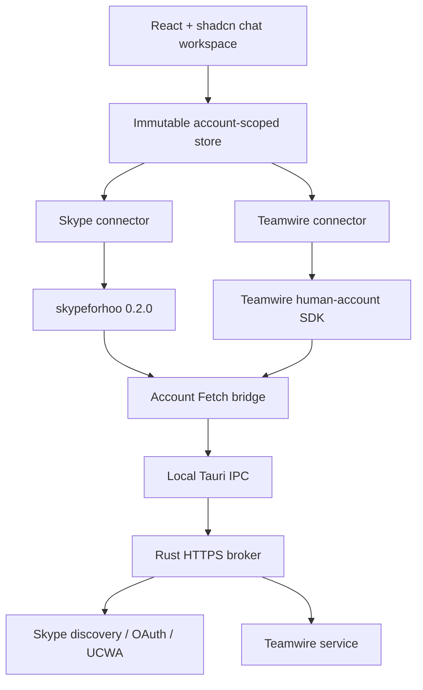

# Chattahoochee architecture

## Boundaries

The WebView runs the SDKs. Rust performs HTTPS requests because provider APIs do not generally grant a third-party WebView cross-origin browser access. The native broker exposes four scoped commands; it does not expose arbitrary shell or filesystem access.

Each account has its own SDK session, abort controller, transport instance and exact origin registry. Provider-native ids are encoded with the account id. Connector events must match the owning account and conversation before they can update the snapshot.

The UI receives normalized records without passwords, access tokens, session keys or conversation keys. It never renders provider HTML as markup. Text attachments and rich message formats need separate implementations.

## Lifecycle

1. Account setup creates a new native transport scope.
2. Initial HTTPS origins come from explicit setup or SDK discovery candidates.
3. Discovered Skype origins go through the visible approval queue before native access is granted.
4. A provider connector authenticates and starts one event/feed consumer.
5. Disconnect immediately disables sends and aborts setup or polling.
6. One shared cleanup promise waits for setup to settle, disposes the SDK and removes the native scope.

Native approval updates are serialized so two approvals cannot lose an origin. Closing is terminal and prevents a delayed update or response from reviving the account.

## Message writes

- The store inserts one optimistic pending row with a fresh operation id.
- A connector sends once using that id where the provider supports it.
- HTTP success establishes acceptance. Protocol delivery/read events may advance it.
- Native provider message ids and client operation ids are reconciled even if the event arrives before the HTTP response.
- An authenticated own-message echo can resolve a previous uncertain failure. A generic HTTP completion cannot erase an explicit provider rejection.
- A message from another sender or conversation cannot claim an outgoing correlation id.
- Failure does not trigger an automatic retry.

History and duplicate feed events do not increase unread counts. Original timestamps remain stable; loading older history cannot move a conversation backwards in the inbox.

## Provider behavior

### Skype for Business

The connector follows UCWA relations advertised by the server. It uses the SDK's discovery, password authentication, application creation, availability, invitation and messaging APIs. SIP address and login username are separate fields. Incoming HTML bodies are converted to inert text. UCWA delivery information is interpreted independently of HTTP status.

Audio/video/application sharing are a separate native media problem. No captured screen or fabricated call state is presented as a Skype session in this preview.

### Teamwire

The workspace SDK implements an independently observed human-account protocol: ephemeral secp256k1 ECDH, encrypted session envelopes, per-conversation keys, nested encrypted text, subscription/history reads and feed polling. It does not use the public bot API to impersonate a human account.

The feed is polled with a cancellable delay and a precise cursor. Read markers are explicit, use a known message id and record the read time. Leaving a conversation disables sending and further reads while retaining already loaded history in memory. Unsupported encryption is represented as unavailable content.

## Storage and qualification

Only theme is persisted. Demo state uses separate ids and is entered explicitly. Live connectors cannot run in demo mode. No tenant addresses or credentials are compiled into defaults.

Unit and integration fixtures prove the implemented state transitions and cryptographic/request shapes against synthetic counterparts. They do not prove production server compatibility, human delivery, native media interoperability or platform acceptance.
