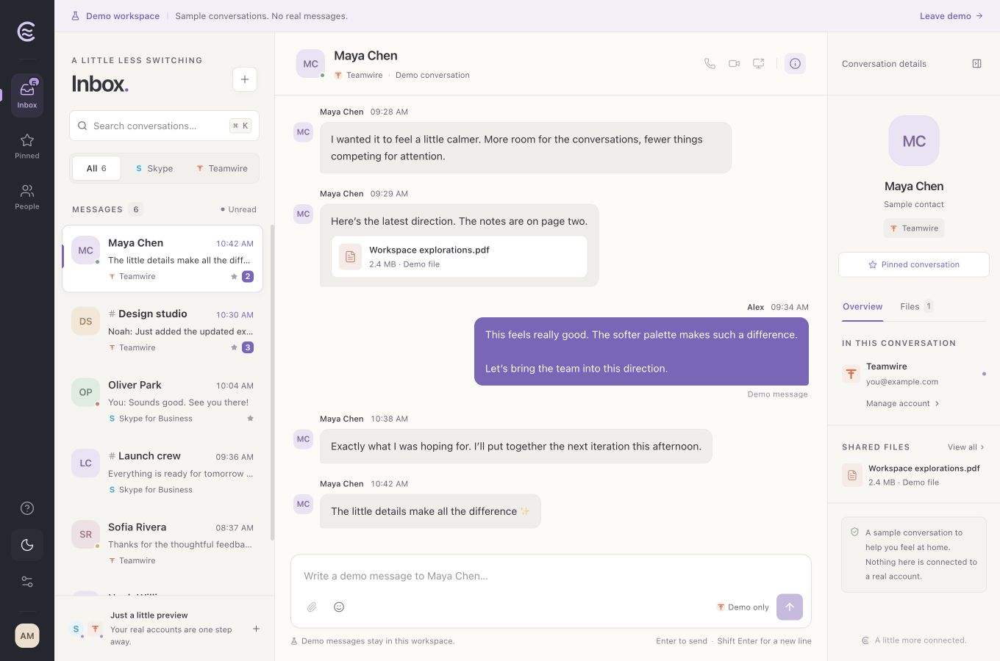
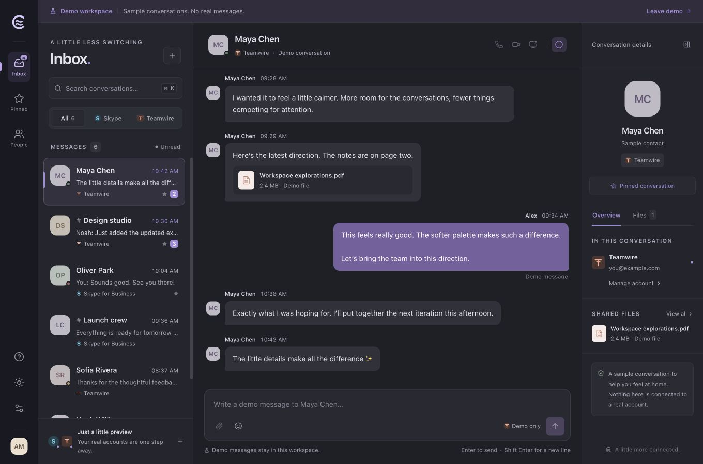
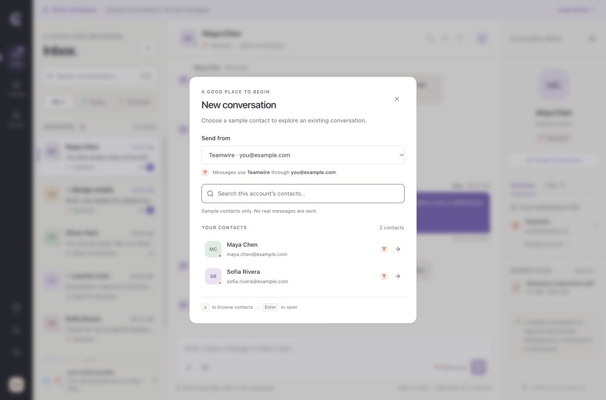

# UI and interaction review

Reviewed on November 4, 2026. The review used the actual React workspace in development and production previews, with synthetic data. It covered visual hierarchy, readability, keyboard navigation, dialog behavior, scrolling and responsive layouts.

## Screens and changes

| Screen or state | Improvements and verification |
| --- | --- |
| Welcome and empty live workspace | Clear account setup and demo entry points; larger secondary text; removed the workspace label’s inactive dropdown indicator. |
| Inbox | Readable 14px conversation titles, visible navigation labels, result counts, clearer dates, separate draft previews and more room in search and filters. |
| Search, provider and unread filters | Whitespace is trimmed; empty states explain the active filter; clearing search or filters restores search focus. |
| Pinned conversations | Counts reflect pinned items; empty copy explains how to pin a conversation. |
| People | Readable names and addresses; pending contact actions prevent duplicate starts; successful navigation focuses the composer. |
| Direct and group conversations | 14px message text, improved muted colors, wrapping for long content, explicit delivery labels and clear session-history wording. |
| Composer and emoji picker | Cursor-aware emoji insertion; Escape and outside dismissal; keyboard focus restoration; a 10,000-character limit; accurate disconnected/unsupported placeholders. |
| Conversation details | Full participant lists; wrapping names and account addresses; tabs reset for a different conversation; View all moves focus into Files. |
| Files, populated and empty | Clear empty states and file metadata; demo files explain that downloads are unavailable. |
| New conversation | Active conversation’s account selected initially; provider/address identify each account; account-scoped counts and empty states; Arrow keys and Enter; readable pending/error states. |
| Account list and demo accounts | Provider, address, connection status and sync counts identify each account; demo accounts remain clearly labeled. |
| Skype setup | Separate advanced login username, automatic discovery guidance, HTTPS discovery validation, readable fields and helpers. |
| Teamwire setup | Server-first setup, explicit HTTPS origin validation and explanation of existing-conversation and authentication limitations. |
| Account setup at limited height | Fields scroll independently; Connect and Cancel remain visible; cancellation clears transient values and restores focus. Browser-only limits are explained before credentials. |
| Appearance | Readable choices, immediate selected-state feedback, light/dark/system behavior and improved contrast. |
| About | Product-oriented copy, preview limitations, keyboard shortcuts, scrolling at limited height and opener restoration. |
| Narrow navigation | Back and search shortcuts reveal and focus the inbox; selecting or starting a conversation reveals and focuses its composer. |
| Narrow details and modal handoffs | Full-height 340px drawer; focus trapping and Escape; account-settings handoffs restore a visible workspace control. |

The primary production views were visually reviewed at the normal desktop size and at 980×640. Navigation and modal handoffs were also exercised at 700×800, below the native window’s minimum width. Light and dark themes were checked. No claim of a complete accessibility conformance audit is made.

## Regression checks

The new `tests/e2e/ux.spec.ts` adds 24 scenarios, executed across the five permanent browser projects. The complete suite now defines 77 scenarios / 385 checks. It covers contextual empty states, isolated draft previews, trimmed searches, emoji cursor/dismissal behavior, readable text sizes, opener restoration, details focus trapping and tab reset, contact navigation and narrow-window handoffs.

Local `npm run check` passes: typecheck, 188 TypeScript tests and the production build. Hosted results for this revision are recorded in [verification](verification.md) after execution. Previous native and protocol tests remain in the same workflows.

Read and failed-delivery labels have theme-specific text colors. Calculated contrast against the transcript background is 5.00:1 and 5.19:1 in light mode, and 8.47:1 and 8.25:1 in dark mode. This verifies those foreground/background pairs, not every color in the application.

## Screenshots

The README images were refreshed from the production preview at 1360×900. They contain synthetic contacts and messages only.

## Limits

The review did not authenticate to an enterprise service or send real provider messages. Browser demo tests cannot establish live interoperability. Audio, video, screen sharing and file transfers still require compatible backends. Windows interactive runtime and assistive-technology acceptance require separate verification. Account state and drafts remain in memory for the current session.
